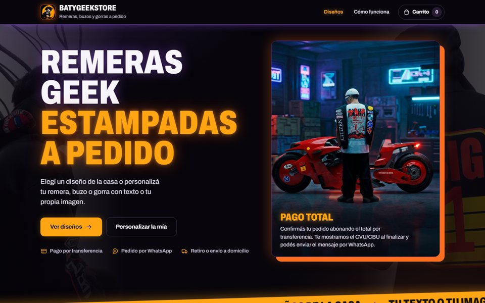
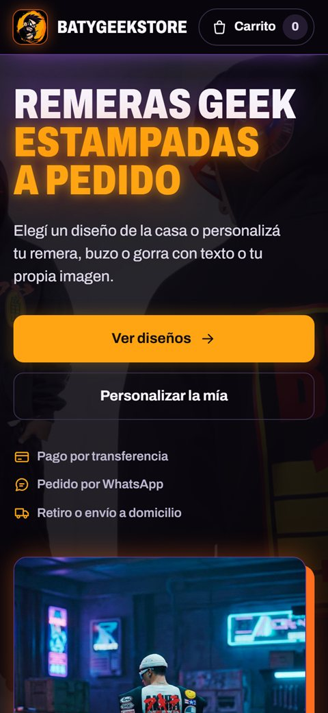

# BatyGeekStore

**Tienda online de remeras, buzos y gorras estampadas a pedido, con el pedido listo para enviar por WhatsApp.**

 
     

 

> [!NOTE]
> Sistema en uso por un negocio real. Los datos del negocio no forman parte de este repositorio.

## Qué resuelve

Una tienda de estampados necesita mostrar sus diseños, dejar que el cliente elija talle y material, y cerrar la venta por el canal que ya usa: WhatsApp. BatyGeekStore reúne todo en una sola web liviana, y el dueño carga y publica sus diseños y precios desde un panel, sin tocar código.

## Funcionalidades

- **Diseños de la casa**: catálogo con carrusel, imagen ampliable y talles a elegir.
- **Productos personalizables**: remera, buzo y gorra, con precio que cambia según el material y la estampa.
- **Carrito y checkout**: el carrito se conserva en el navegador del cliente.
- **Pedido por WhatsApp**: el mensaje sale armado con todos los datos del pedido.
- **Envío o retiro**: costo de envío configurable por el dueño.
- **Panel de administración integrado**: carga de diseños, precios y envío, con acceso protegido por clave.
- **Publicación para todos**: lo que el dueño publica lo ven todos los clientes, no solo un navegador.
- **Imágenes optimizadas**: se suben a Cloudinary y se muestran en tamaños livianos.
- **Pensada para el celular**: diseño adaptable con fondo temático y videos de cada producto.

## Capturas

<table>
  <tr>
    <td width="70%"></td>
    <td width="30%"></td>
  </tr>
  <tr>
    <td align="center">En la computadora</td>
    <td align="center">En el celular</td>
  </tr>
</table>

## Tecnologías

| Parte | Tecnología |
| --- | --- |
| Interfaz | HTML, CSS y JavaScript sin framework (aplicación de una sola página) |
| Servidor | Función de Vercel (`api/store.js`) |
| Base de datos | Upstash Redis (REST) |
| Imágenes | Cloudinary |
| Pedidos | Mensaje de WhatsApp |
| Publicación | Vercel |

## Para desarrolladores

<b>Cómo publicarlo</b>

No tiene dependencias ni paso de compilación.

1. Subir el repositorio a GitHub e importarlo en Vercel.
2. En Vercel, crear una base **Upstash for Redis** desde Storage y conectarla al proyecto.
3. Cargar las variables de entorno (ver el bloque siguiente) y volver a publicar.
4. Verificar que `https://TU_DOMINIO/api/store` responda con `meta.kvConfigured = true`.

<b>Variables de entorno</b>

Se cargan en Vercel, en Settings, Environment Variables.

| Variable | Para qué |
| --- | --- |
| `ADMIN_KEY` | Clave que autoriza publicar desde el panel (header `x-admin-key`) |
| `UPSTASH_REDIS_REST_URL` | Dirección de la base Redis |
| `UPSTASH_REDIS_REST_TOKEN` | Credencial de la base Redis |
| `KV_REST_API_URL`, `KV_REST_API_TOKEN` | Nombres alternativos de los dos anteriores |

Cloudinary usa un upload preset sin firma, que se configura en la pantalla `#/config` de la web.

<b>Estructura del proyecto</b>

| Archivo | Rol |
| --- | --- |
| `index.html` | Estructura base y carga de la aplicación |
| `styles.css` | Estilos |
| `app.js` | Rutas por hash (`#/`, `#/producto`, `#/diseno`, `#/carrito`, `#/checkout`, `#/como-funciona`, `#/admin`), carrito, checkout y panel |
| `app-data.js` | Configuración, catálogo y precios base |
| `api/store.js` | Lectura y escritura de lo publicado en Redis, con validación de datos |

<b>Seguridad de la publicación</b>

- Validación del contenido recibido, con límite de 1 MB por pedido y de 200 diseños.
- Los diseños y precios se sanean antes de guardarse o devolverse.
- La clave del panel no está en el código: se define como variable de entorno.

---

Diseñado y desarrollado por **[laruzo-dev](https://laruzo-dev-ar.vercel.app)**
 
¿Querés un sistema así para tu negocio? <a href="https://laruzo-dev-ar.vercel.app/#contacto">Hablemos</a>.

